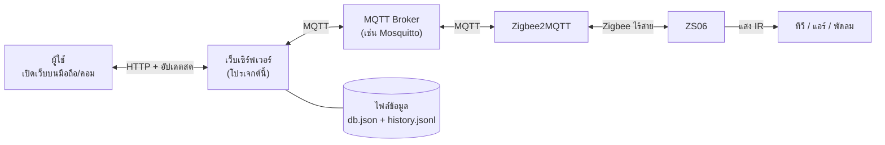
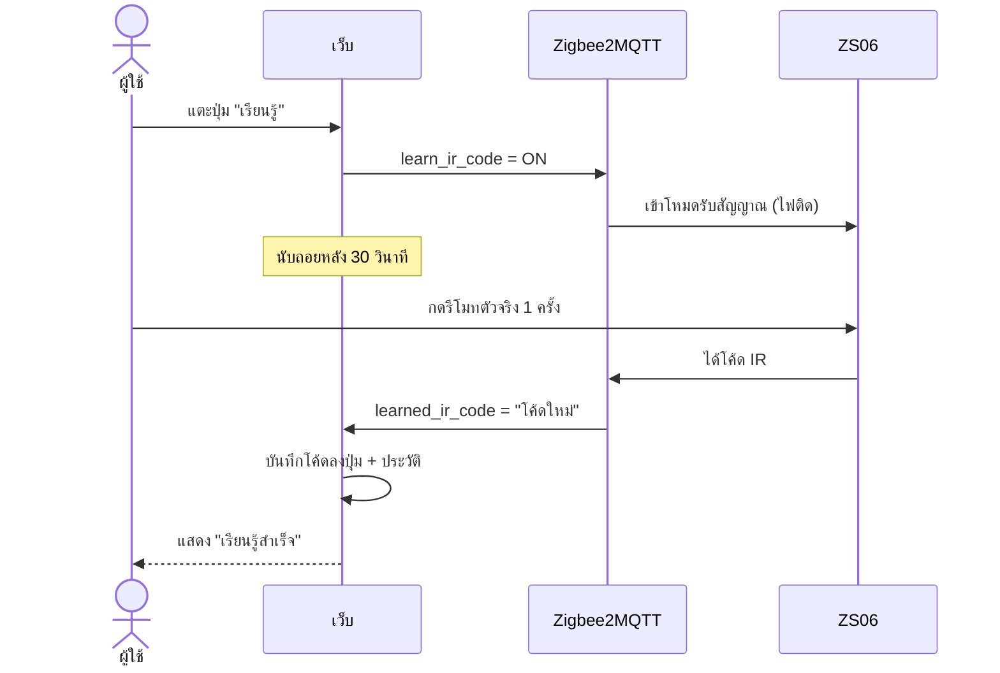
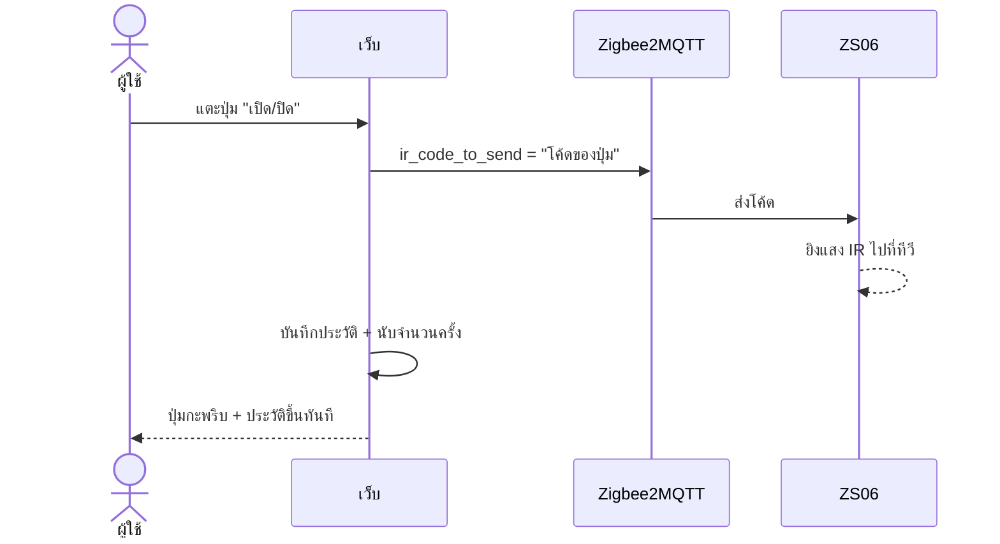

# Z2M IR Remote

เว็บรีโมทสำหรับ **Tuya ZS06** (ตัวส่งอินฟราเรดแบบ Zigbee) ที่ต่อผ่าน **Zigbee2MQTT**
สร้างปุ่มเอง สอนปุ่มจากรีโมทจริง กดสั่งทีวี แอร์ พัดลม จากมือถือหรือคอม และเก็บประวัติการกดทุกครั้ง

*Web remote for Tuya ZS06 IR blaster via Zigbee2MQTT: learn, send and log IR codes.*

---

## ทำอะไรได้บ้าง

| ความสามารถ | รายละเอียด |
|---|---|
| สร้างรีโมท | เลือกแม่แบบ ทีวี แอร์ พัดลม กล่องทีวี ไฟ หรือเริ่มจากว่างเปล่า |
| สอนปุ่ม (Learn) | หันรีโมทตัวจริงไปที่ ZS06 แล้วกด ระบบจำโค้ดให้อัตโนมัติ |
| กดสั่งงาน | แตะปุ่มบนเว็บ ZS06 ยิงสัญญาณ IR ไปที่เครื่องใช้ไฟฟ้า |
| เก็บประวัติ | บันทึกทุกการกดและการสอน ดูย้อนหลังได้ ดาวน์โหลดเป็น Excel (CSV) ได้ |
| ใช้ได้ทุกจอ | มือถือ แท็บเล็ต คอม รองรับโหมดมืด |
| เชื่อมระบบอื่น | Home Assistant, Node-RED หรือสคริปต์ สั่งกดปุ่มผ่าน HTTP ได้ |

---

## หลักการทำงาน

### ภาพรวม



คิดแบบง่าย ๆ ว่าเป็น **การส่งต่อข้อความเป็นทอด ๆ**

1. **เว็บ** รับคำสั่งจากผู้ใช้ แล้วแปลงเป็นข้อความ MQTT
2. **MQTT Broker** เป็นเหมือนไปรษณีย์กลาง รับข้อความแล้วส่งต่อให้คนที่รอฟังหัวข้อ (topic) นั้น
3. **Zigbee2MQTT** แปลข้อความ MQTT เป็นสัญญาณ Zigbee แล้วส่งไปที่ ZS06
4. **ZS06** ยิงแสงอินฟราเรดออกไป เหมือนรีโมทตัวจริงกด

เว็บไม่ได้คุยกับ ZS06 ตรง ๆ ทุกอย่างผ่าน MQTT ทั้งหมด จึงใช้ร่วมกับ Zigbee2MQTT ที่มีอยู่แล้วได้ทันที ไม่ต้องติดตั้งอะไรเพิ่มบนอุปกรณ์

### ขั้นตอนการสอนปุ่ม (Learn)



**จุดที่ควรรู้:** Zigbee2MQTT ชอบส่งโค้ด **เก่า** ที่จำไว้กลับมาทันทีที่เริ่มสอน เว็บจึงจำโค้ดเก่าไว้ก่อน แล้วรับเฉพาะโค้ดที่ **เปลี่ยนไป** เท่านั้น ป้องกันการบันทึกโค้ดผิดปุ่ม

### ขั้นตอนการกดปุ่ม (Send)



### การค้นหาอุปกรณ์อัตโนมัติ

Zigbee2MQTT ประกาศรายชื่ออุปกรณ์ทั้งหมดไว้ที่ topic `zigbee2mqtt/bridge/devices` เว็บอ่านรายการนี้ แล้วเลือกเฉพาะตัวที่ส่ง IR ได้ (มีความสามารถ `ir_code_to_send`) มาแสดง

ถ้าบน broker มี Zigbee2MQTT **หลายชุด** (base topic ต่างกัน เช่น `zigbee2mqtt`, `zigbee2mqtt1`) เว็บจะตรวจเจอทุกชุด และเสนอให้กดสลับไปชุดที่มี ZS06 ได้ในคลิกเดียว

---

## เริ่มใช้งาน

**สิ่งที่ต้องมี:** Node.js 18 ขึ้นไป, MQTT Broker, Zigbee2MQTT ที่ pair ZS06 ไว้แล้ว

```bash
git clone https://github.com/watggwp/z2m-ir-remote.git
cd z2m-ir-remote
npm install
npm start
```

เปิด **http://localhost:3000** (หรือ `http://<IP เครื่องนี้>:3000` จากมือถือในวง LAN เดียวกัน)

### ตั้งค่าครั้งแรก

1. กดปุ่ม **MQTT** มุมขวาบน
2. ใส่ที่อยู่ broker เช่น `mqtt://192.168.1.10:1883` พร้อม username/password (ถ้ามี)
3. Base topic ใช้ `zigbee2mqtt` ตามค่าเริ่มต้น หรือกดเลือกจากรายการที่เว็บค้นเจอ
4. กด **บันทึกและเชื่อมต่อ** ไฟสถานะเป็นสีเขียวแปลว่าพร้อม

### ลองเล่นโดยไม่มีอุปกรณ์จริง

```bash
npm run demo    # จำลอง broker และ ZS06 2 เครื่อง ข้อมูลแยกไว้ที่ data-demo/
npm test        # ทดสอบอัตโนมัติทั้งขั้นตอน สร้าง > สอน > สอนซ้ำ > กด > ประวัติ
```

---

## วิธีใช้งาน

| ต้องการ | ทำอย่างไร |
|---|---|
| เพิ่มรีโมท | กด **+ เพิ่ม** เลือกอุปกรณ์ ZS06 และแม่แบบ |
| สอนปุ่ม | แตะปุ่มที่มี **ขอบเส้นประ** (ยังไม่มีโค้ด) แล้วกดรีโมทจริงใส่ ZS06 ภายใน 30 วินาที ระยะ 5 ถึง 15 ซม. |
| กดสั่งงาน | แตะปุ่มปกติ |
| แก้ชื่อ ไอคอน สี | เปิด **โหมดแก้ไข** แล้วแตะปุ่ม |
| สอนปุ่มใหม่ | โหมดแก้ไข แล้วกดไอคอนสัญญาณมุมบนของปุ่ม |
| จัดเรียงปุ่ม | โหมดแก้ไข แล้วลากปุ่มไปวาง |
| ดูประวัติ | แผงด้านขวา กรองได้ ทั้งหมด / รีโมทนี้ / การเรียนรู้ |
| สำรองข้อมูล | ตั้งค่า > ส่งออกรีโมททั้งหมด (.json) |

---

## ข้อมูลเก็บที่ไหน

เก็บเป็นไฟล์ JSON ธรรมดาในโฟลเดอร์ `data/` ไม่ต้องติดตั้งฐานข้อมูล

| ไฟล์ | เก็บอะไร | ลักษณะ |
|---|---|---|
| `data/db.json` | ตั้งค่า MQTT, รีโมท, ปุ่ม, โค้ด IR, จำนวนครั้งที่กด | เขียนทับทั้งไฟล์แบบปลอดภัย (ไม่พังถ้าไฟดับกลางคัน) |
| `data/history.jsonl` | ประวัติทุกการกดและการสอน | ต่อท้ายทีละบรรทัด ไม่ลบของเก่า |

ตัวอย่างประวัติ 1 บรรทัด:

```json
{"ts":"2026-10-19T06:54:45.120Z","type":"press","ok":true,"remoteName":"ทีวีห้องนั่งเล่น","buttonName":"เปิด/ปิด","device":"IR Living Room","source":"web"}
```

สำรองข้อมูลได้ง่ายที่สุดด้วยการคัดลอกโฟลเดอร์ `data/` ทั้งโฟลเดอร์

---

## แก้ปัญหาที่พบบ่อย

| อาการ | สาเหตุที่เป็นไปได้ | วิธีแก้ |
|---|---|---|
| ไฟสถานะ MQTT สีแดง | ที่อยู่ broker หรือรหัสผ่านผิด | ตรวจในหน้าตั้งค่า ลอง ping IP ของ broker |
| "ไม่พบอุปกรณ์ IR" | base topic ไม่ตรงกับ Zigbee2MQTT ที่มี ZS06 | กด **ใช้ชุดนี้** ที่เว็บเสนอ หรือเลือก base topic ในหน้าตั้งค่า |
| ยังไม่เคย pair ZS06 | อุปกรณ์ยังไม่อยู่ใน Zigbee2MQTT | หน้า Zigbee2MQTT กด Permit join แล้วกดปุ่มรีเซ็ตบน ZS06 ค้างจนไฟกะพริบเร็ว |
| สอนปุ่มแล้วหมดเวลา | หันผิดทิศ ไกลเกินไป หรือ ZS06 ออฟไลน์ | เข้าใกล้ 5 ถึง 15 ซม. กดครั้งเดียวไม่ต้องกดค้าง |
| กดแล้วเครื่องไม่ตอบสนอง | ZS06 มองไม่เห็นเครื่อง หรือโค้ดไม่ครบ | ย้าย ZS06 ให้เห็นเครื่องปลายทาง แล้วสอนปุ่มใหม่ |
| แอร์สั่งได้บางปุ่ม | รีโมทแอร์ส่งสถานะทั้งชุดในแต่ละครั้ง | สอนแยกเป็นปุ่มตามสถานะ เช่น "เย็น 25 องศา", "เย็น 27 องศา" |

---

## สำหรับนักพัฒนา

### โครงสร้างโปรเจกต์

```
server.js            เว็บเซิร์ฟเวอร์ + HTTP API + อัปเดตสด (SSE)
lib/bridge.js        คุยกับ MQTT: ค้นหาอุปกรณ์ ส่งโค้ด จัดการการสอนปุ่ม
lib/store.js         อ่าน/เขียนไฟล์ข้อมูล JSON
public/              หน้าเว็บ (HTML, CSS, JavaScript ล้วน ไม่ต้อง build)
tools/simulator.js   broker + ZS06 จำลอง สำหรับ npm run demo
tools/smoke-test.js  ทดสอบอัตโนมัติ
```

### MQTT topics ที่ใช้

| ทิศทาง | Topic | Payload |
|---|---|---|
| เว็บ > ZS06 ส่ง IR | `zigbee2mqtt/<ชื่ออุปกรณ์>/set` | `{"ir_code_to_send": "<code>"}` |
| เว็บ > ZS06 เริ่มสอน | `zigbee2mqtt/<ชื่ออุปกรณ์>/set` | `{"learn_ir_code": "ON"}` |
| ZS06 > เว็บ ได้โค้ด | `zigbee2mqtt/<ชื่ออุปกรณ์>` | `{"learned_ir_code": "<code>"}` |
| ค้นหาอุปกรณ์ | `+/bridge/devices` | รายชื่ออุปกรณ์ของทุก Zigbee2MQTT |
| สถานะออนไลน์ | `zigbee2mqtt/<ชื่ออุปกรณ์>/availability` | `{"state": "online"}` |

### HTTP API

สั่งกดปุ่มจากระบบอื่น (ดู `remoteId` และ `buttonId` ได้จาก `GET /api/state`):

```bash
curl -X POST http://localhost:3000/api/remotes/<remoteId>/buttons/<buttonId>/press \
     -H "Content-Type: application/json" -d '{"source":"homeassistant"}'
```

| Method | Path | หน้าที่ |
|---|---|---|
| GET | `/api/state` | ข้อมูลทั้งหมด รีโมท อุปกรณ์ สถานะ MQTT |
| GET | `/api/events` | อัปเดตสดแบบ Server-Sent Events |
| POST, PATCH, DELETE | `/api/remotes[/:id]` | จัดการรีโมท |
| POST, PATCH, DELETE | `/api/remotes/:id/buttons[/:bid]` | จัดการปุ่ม |
| POST | `/api/remotes/:id/buttons/:bid/press` | ส่ง IR และบันทึกประวัติ |
| POST | `/api/remotes/:id/buttons/:bid/learn` | เริ่มสอนปุ่ม (ผลส่งกลับทาง SSE) |
| GET | `/api/history?limit=&remoteId=&type=` | ประวัติ (`type` คือ `press` หรือ `learn`) |
| GET | `/api/history.csv` | ดาวน์โหลดประวัติเป็น CSV |
| GET, POST | `/api/export`, `/api/import` | สำรองและกู้คืนรีโมท |

### ตั้งค่าผ่าน environment variables

| ตัวแปร | ค่าเริ่มต้น | ความหมาย |
|---|---|---|
| `PORT` | `3000` | พอร์ตของเว็บ |
| `MQTT_URL` | `mqtt://localhost:1883` | ที่อยู่ broker (ใช้ครั้งแรกเท่านั้น หลังจากนั้นแก้ในหน้าเว็บ) |
| `MQTT_USER`, `MQTT_PASS` | ว่าง | บัญชี MQTT |
| `BASE_TOPIC` | `zigbee2mqtt` | base topic ของ Zigbee2MQTT |
| `DATA_DIR` | `./data` | โฟลเดอร์เก็บข้อมูล |

---

## ข้อจำกัดที่ควรรู้

- **ไม่มีระบบล็อกอิน** ออกแบบมาให้ใช้ในวง LAN ถ้าจะเปิดให้เข้าจากนอกบ้าน/ออฟฟิศ ให้ใช้ VPN หรือ reverse proxy ที่มีการยืนยันตัวตน
- **รหัสผ่าน MQTT** เก็บใน `data/db.json` แบบข้อความธรรมดา (ไฟล์นี้ไม่ถูกส่งขึ้น git และหน้าเว็บไม่แสดงรหัส)
- **"สำเร็จ" ในประวัติ** หมายถึงคำสั่งถึง broker แล้ว ZS06 ไม่ส่งยืนยันกลับว่าทีวีหรือแอร์รับสัญญาณจริง
- **สอนปุ่มเดิมซ้ำได้โค้ดเหมือนเดิมทุกไบต์** ระบบจะรอจนหมดเวลา แต่โค้ดเดิมยังใช้ได้ตามปกติ
- **กดถี่มาก** ZS06 ส่งได้ทีละคำสั่ง บางคำสั่งอาจหลุด

---

## คำศัพท์

| คำ | ความหมาย |
|---|---|
| **IR (Infrared)** | แสงอินฟราเรดที่รีโมททั่วไปใช้สั่งเครื่องใช้ไฟฟ้า ตาคนมองไม่เห็น |
| **IR code / โค้ด IR** | ข้อมูลรูปแบบสัญญาณของปุ่มหนึ่งปุ่ม เก็บเป็นข้อความ (base64) |
| **ZS06** | อุปกรณ์ Tuya ที่รับคำสั่งทาง Zigbee แล้วยิง IR ออกไป ทำตัวเป็นรีโมทอัจฉริยะ |
| **Zigbee** | เครือข่ายไร้สายพลังงานต่ำสำหรับอุปกรณ์สมาร์ทโฮม |
| **Zigbee2MQTT (Z2M)** | โปรแกรมที่แปลงอุปกรณ์ Zigbee ให้คุยผ่าน MQTT ได้ |
| **MQTT** | โปรโตคอลส่งข้อความแบบ "ประกาศ/ติดตาม" นิยมใช้ใน IoT |
| **Broker** | เซิร์ฟเวอร์กลางของ MQTT ทำหน้าที่ส่งต่อข้อความ เช่น Mosquitto |
| **Topic** | หัวข้อของข้อความ MQTT เช่น `zigbee2mqtt/IR Living Room/set` |
| **Base topic** | คำนำหน้า topic ของ Zigbee2MQTT แต่ละชุด ค่าเริ่มต้นคือ `zigbee2mqtt` |
| **Friendly name** | ชื่ออุปกรณ์ที่ตั้งใน Zigbee2MQTT เว็บใช้ชื่อนี้อ้างอิงอุปกรณ์ |
| **Learn / สอนปุ่ม** | ให้ ZS06 จำสัญญาณจากรีโมทตัวจริง |
| **Pair** | การเพิ่มอุปกรณ์ Zigbee เข้าเครือข่าย |
| **SSE (Server-Sent Events)** | วิธีที่เซิร์ฟเวอร์ส่งข้อมูลใหม่มาที่หน้าเว็บทันที โดยไม่ต้องกดรีเฟรช |
| **JSON / JSONL** | รูปแบบไฟล์ข้อมูลที่คนอ่านได้ JSONL คือ JSON หนึ่งรายการต่อหนึ่งบรรทัด |
